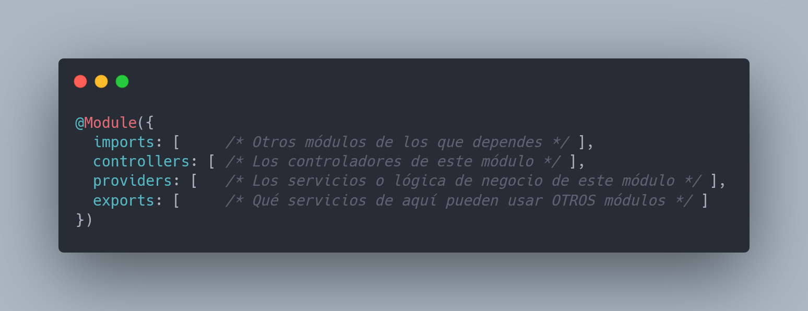
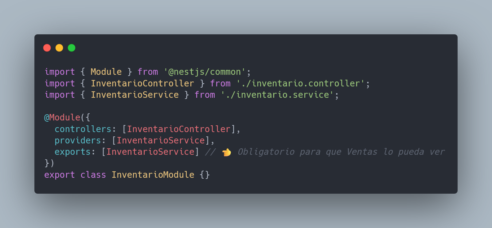
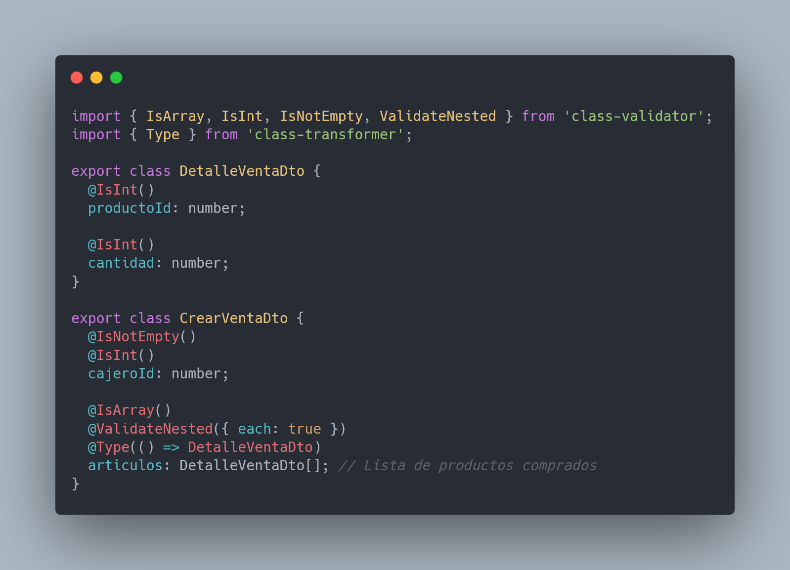
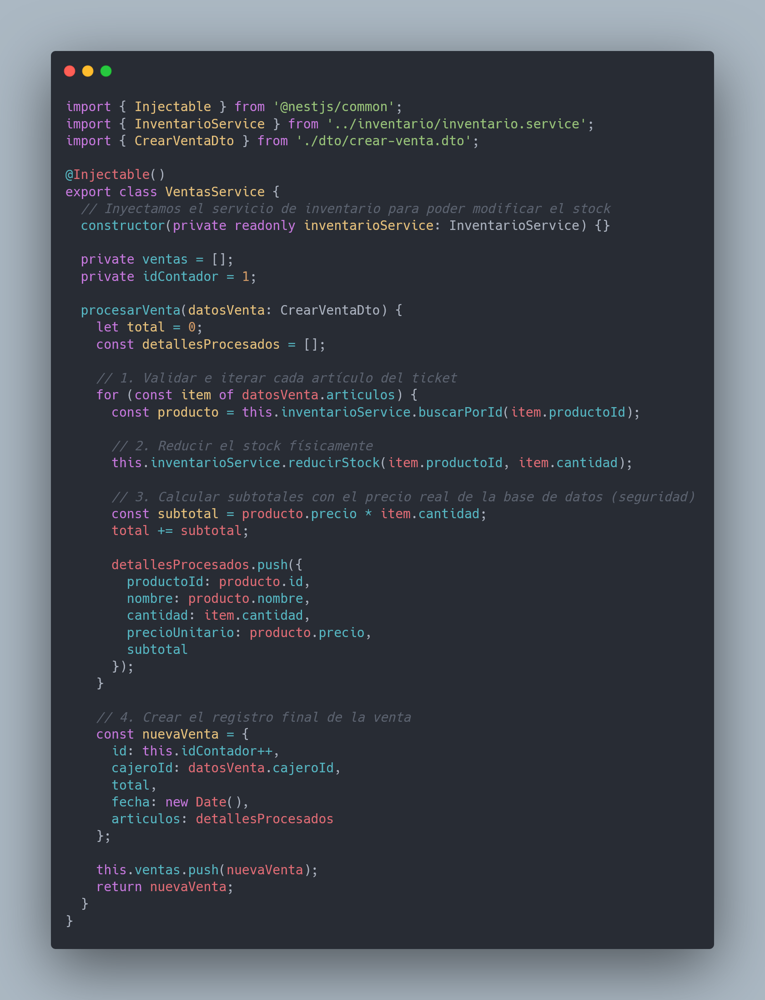
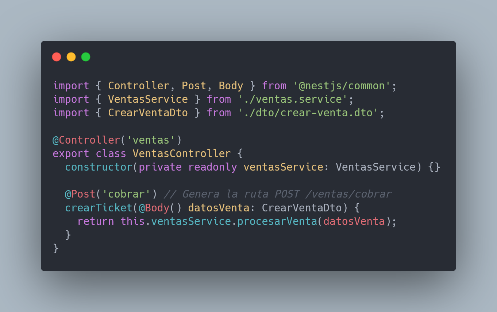
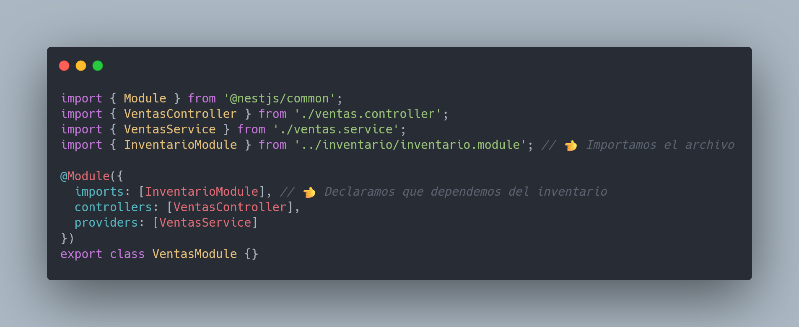
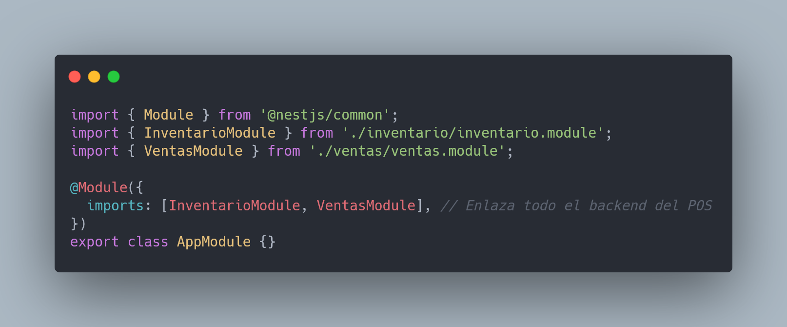

# Arquitectura de Backend para un POS con NestJS

Este documento detalla la estructura modular recomendada para el backend de un sistema de Punto de Venta (POS) utilizando NestJS y TypeScript.

---

## Estructura de Archivos del Proyecto

```text
src/
├── app.module.ts                 # Módulo raíz que conecta todo
├── main.ts                       # Punto de entrada de la aplicación
├── inventario/                   # Módulo de Productos/Inventario
│   ├── inventario.module.ts
│   ├── inventario.controller.ts
│   ├── inventario.service.ts
│   └── dto/
│       └── crear-producto.dto.ts # Validación de datos entrantes
└── ventas/                       # Módulo de Ventas/Transacciones
    ├── ventas.module.ts
    ├── ventas.controller.ts
    ├── ventas.service.ts
    └── dto/
        └── crear-venta.dto.ts
```

---

## El Rol de los Archivos `*.module.ts`

Los módulos en NestJS son clases decoradas con `@Module()` que actúan como organizadores principales del código. Su función es encapsular y agrupar de forma lógica controladores, servicios y DTOs de una misma característica del negocio (ej. Ventas, Inventario).

### Propiedades de un Módulo:
* **imports:** Listado de otros módulos que exportan servicios necesarios para este módulo.
* **controllers:** Controladores definidos en este módulo que deben instanciarse.
* **providers:** Servicios que alojan la lógica de negocio y serán inyectados por NestJS.
* **exports:** Proveedores/servicios que este módulo pone a disposición de otros módulos.



---

## Código de las Clases Principales

### 1. Módulo de Inventario (`src/inventario/inventario.module.ts`)
```typescript
import { Module } from '@nestjs/common';
import { InventarioController } from './inventario.controller';
import { InventarioService } from './inventario.service';

@Module({
  controllers: [InventarioController],
  providers: [InventarioService],
  exports: [InventarioService] // Permite que Ventas lo utilice
})
export class InventarioModule {}
```



### 2. Servicio de Inventario (`src/inventario/inventario.service.ts`)
```typescript
import { Injectable, BadRequestException } from '@nestjs/common';

@Injectable()
export class InventarioService {
  private productos = [
    { id: 1, nombre: 'Café Espresso', precio: 2.50, stock: 10 },
    { id: 2, nombre: 'Croissant', precio: 1.80, stock: 5 },
  ];

  buscarPorId(id: number) {
    const producto = this.productos.find(p => p.id === id);
    if (!producto) throw new BadRequestException(`Producto #${id} no existe`);
    return producto;
  }

  reducirStock(id: number, cantidad: number) {
    const producto = this.buscarPorId(id);
    if (producto.stock < cantidad) {
      throw new BadRequestException(`Stock insuficiente para ${producto.nombre}`);
    }
    producto.stock -= cantidad;
    return producto;
  }
}
```


### 3. DTO de Ventas (`src/ventas/dto/crear-venta.dto.ts`)
```typescript
import { IsArray, IsInt, IsNotEmpty, ValidateNested } from 'class-validator';
import { Type } from 'class-transformer';

export class DetalleVentaDto {
  @IsInt()
  productoId: number;

  @IsInt()
  cantidad: number;
}

export class CrearVentaDto {
  @IsNotEmpty()
  @IsInt()
  cajeroId: number;

  @IsArray()
  @ValidateNested({ each: true })
  @Type(() => DetalleVentaDto)
  articulos: DetalleVentaDto[];
}
```



### 4. Servicio de Ventas (`src/ventas/ventas.service.ts`)
```typescript
import { Injectable } from '@nestjs/common';
import { InventarioService } from '../inventario/inventario.service';
import { CrearVentaDto } from './dto/crear-venta.dto';

@Injectable()
export class VentasService {
  constructor(private readonly inventarioService: InventarioService) {}

  private ventas = [];
  private idContador = 1;

  procesarVenta(datosVenta: CrearVentaDto) {
    let total = 0;
    const detallesProcesados = [];

    for (const item of datosVenta.articulos) {
      const producto = this.inventarioService.buscarPorId(item.productoId);
      this.inventarioService.reducirStock(item.productoId, item.cantidad);

      const subtotal = producto.precio * item.cantidad;
      total += subtotal;

      detallesProcesados.push({
        productoId: producto.id,
        nombre: producto.nombre,
        cantidad: item.cantidad,
        precioUnitario: producto.precio,
        subtotal
      });
    }

    const nuevaVenta = {
      id: this.idContador++,
      cajeroId: datosVenta.cajeroId,
      total,
      fecha: new Date(),
      articulos: detallesProcesados
    };

    this.ventas.push(nuevaVenta);
    return nuevaVenta;
  }
}
```



### 5. El controlador de Ventas (`src/ventas/ventas.controller.ts`)
```typescript
import { Controller, Post, Body } from '@nestjs/common';
import { VentasService } from './ventas.service';
import { CrearVentaDto } from './dto/crear-venta.dto';

@Controller('ventas')
export class VentasController {
  constructor(private readonly ventasService: VentasService) {}

  @Post('cobrar') // Genera la ruta POST /ventas/cobrar
  crearTicket(@Body() datosVenta: CrearVentaDto) {
    return this.ventasService.procesarVenta(datosVenta);
  }
}
```



### 6. Módulo de Ventas (`src/ventas/ventas.module.ts`)
```typescript
import { Module } from '@nestjs/common';
import { VentasController } from './ventas.controller';
import { VentasService } from './ventas.service';
import { InventarioModule } from '../inventario/inventario.module';

@Module({
  imports: [InventarioModule], // Importa la funcionalidad de inventario
  controllers: [VentasController],
  providers: [VentasService]
})
export class VentasModule {}
```



### 7. Módulo Raíz (`src/app.module.ts`)
```typescript
import { Module } from '@nestjs/common';
import { InventarioModule } from './inventario/inventario.module';
import { VentasModule } from './ventas/ventas.module';

@Module({
  imports: [InventarioModule, VentasModule],
})
export class AppModule {}
```

